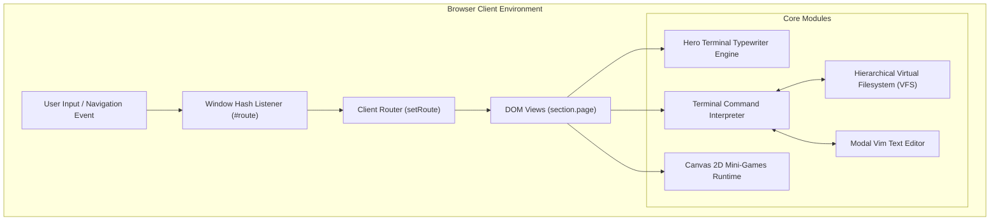
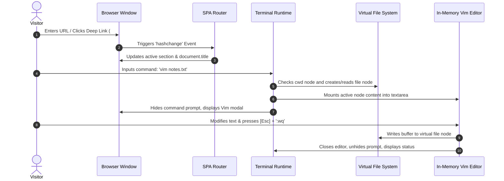
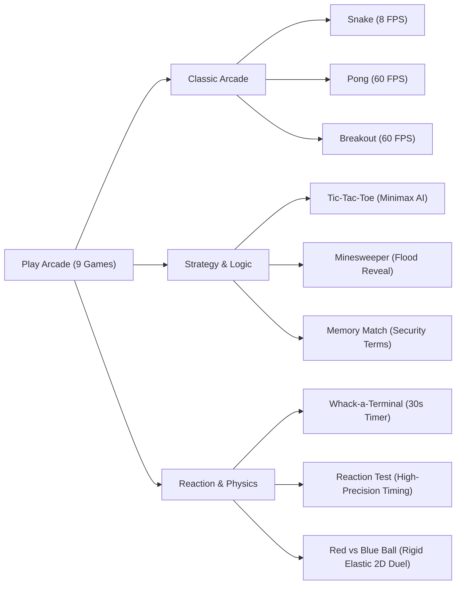

<div align="center">

# 🛡️ portfolio-Harsh-Vishwakarma

**A Security-Focused, High-Performance Interactive Developer Portfolio & Terminal Sandbox**

[](LICENSE)
[](https://developer.mozilla.org/en-US/docs/Web/HTML)
[](https://developer.mozilla.org/en-US/docs/Web/CSS)
[](https://developer.mozilla.org/en-US/docs/Web/JavaScript)
[](#-security--performance-features)
[](#-author--connect)

<p align="center">
  <a href="#-project-overview">Overview</a> •
  <a href="#-key-features">Features</a> •
  <a href="#-system-architecture">Architecture</a> •
  <a href="#-virtual-filesystem--terminal-specification">Terminal & VFS</a> •
  <a href="#-arcade-engine--mini-games">Mini-Games Engine</a> •
  <a href="#-project-structure">Project Structure</a> •
  <a href="#-getting-started--installation">Getting Started</a> •
  <a href="#-deployment-guide">Deployment</a> •
  <a href="#-author--connect">Author</a>
</p>

</div>

---

## 📖 Table of Contents

- [📖 Table of Contents](#-table-of-contents)
- [🌟 Project Overview](#-project-overview)
- [✨ Key Features](#-key-features)
- [📐 System Architecture](#-system-architecture)
  - [High-Level Application Dataflow](#high-level-application-dataflow)
  - [Component Interaction Topology](#component-interaction-topology)
- [💻 Technology Stack](#-technology-stack)
- [🗂️ Project Structure](#️-project-structure)
  - [Detailed File Responsibilities](#detailed-file-responsibilities)
- [🖥️ Virtual Filesystem & Terminal Specification](#️-virtual-filesystem--terminal-specification)
  - [Terminal Architecture](#terminal-architecture)
  - [Command Reference Matrix](#command-reference-matrix)
  - [Integrated In-Memory Vim Editor Subsystem](#integrated-in-memory-vim-editor-subsystem)
- [🎮 Arcade Engine & Mini-Games](#-arcade-engine--mini-games)
  - [Canvas DPI & Coordinate Correction Pipeline](#canvas-dpi--coordinate-correction-pipeline)
  - [Mini-Game Catalog](#mini-game-catalog)
- [🔒 Security & Performance Features](#-security--performance-features)
- [🚀 Getting Started & Installation](#-getting-started--installation)
  - [Prerequisites](#prerequisites)
  - [Local Setup](#local-setup)
- [🌐 Deployment Guide](#-deployment-guide)
  - [Deploy to GitHub Pages](#deploy-to-github-pages)
  - [Deploy to Vercel / Netlify](#deploy-to-vercel--netlify)
- [🔧 Troubleshooting & FAQ](#-troubleshooting--faq)
- [🗺️ Roadmap & Future Enhancements](#️-roadmap--future-enhancements)
- [🤝 Contributing Guidelines](#-contributing-guidelines)
- [📄 License](#-license)
- [👨‍💻 Author & Connect](#-author--connect)

---

## 🌟 Project Overview

**portfolio-Harsh-Vishwakarma** is an enterprise-grade, zero-dependency, static personal portfolio and cybersecurity showcase built for **Harsh Vishwakarma** (DevOps Engineer in Cyber Security at Tata Consultancy Services).

Unlike conventional static resumes, this web platform demonstrates production-level engineering principles:
1. **Separation of Concerns**: Fully decoupled architecture dividing semantic markup (`index.html`), structured design tokens and components (`css/style.css`), and modular event-driven application logic (`js/script.js`).
2. **Interactive Unix-like Environment**: An in-browser terminal emulator powered by a hierarchical in-memory Virtual File System (VFS) and a custom multimodal Vim text editor.
3. **Hardware-Accelerated HTML5 Canvas Arcade**: Nine retro and logic mini-games (including Snake, Pong, Breakout, Minimax-driven Tic-Tac-Toe, Minesweeper, Memory Match, Whack-a-Mole, Reaction Timer, and 2D Rigid Body Physics Bumper Arena) featuring automatic DPI hit-testing corrections.
4. **Deep-Linking Hash Router**: Single Page Application (SPA) architecture providing deep bookmarking, browser history integration, accessible screen-reader live regions, and WCAG-compliant keyboard navigation.

---

## ✨ Key Features

- ⚡ **Zero External Framework Overhead**: Pure vanilla HTML5, modern CSS3 variables, and clean ES6 JavaScript; runs instantaneously with zero build step.
- 🧭 **Hash-Based Deep-Link Routing**: Seamless URL states (`#home`, `#about`, `#skills`, `#projects`, `#experience`, `#contact`, `#terminal`, `#play`) with document title synchronization and focus control.
- 💻 **In-Browser Terminal & Virtual File System (VFS)**:
  - Real directory tree traversal (`ls`, `cd`, `pwd`, `cat`, `mkdir`, `touch`, `rm`, `clear`).
  - Terminal history scrolling via `ArrowUp` and `ArrowDown`.
  - Built-in live modal editor with standard Vim states (`-- INSERT --`, `-- COMMAND --`, `:w`, `:q`, `:wq`, `:q!`).
- 🕹️ **HTML5 Canvas Mini-Games Engine**:
  - RequestAnimationFrame (RAF) rendering loops throttled to target frame rates (8 FPS to 60 FPS).
  - High-precision aspect-ratio scaling ensuring accurate mouse hit coordinates regardless of screen dimensions.
  - Zero-sum Minimax decision tree AI in Tic-Tac-Toe.
- 📱 **Adaptive & Responsive UX**:
  - CSS Grid and Flexbox layouts optimized for mobile (<560px), tablet (<860px), laptop (<900px), and desktop (>1120px).
  - Accessible slide-out navigation drawer on mobile viewports.
- ♿ **Accessibility First (A11y)**:
  - Accessible Skip-to-Content navigation link.
  - Native collapsible disclosures (`<details>` / `<summary>`) for career progression.
  - Strict motion safety using `@media (prefers-reduced-motion: reduce)`.
  - Semantic ARIA attributes (`aria-expanded`, `aria-current`, `aria-live`, `aria-modal`, `role="dialog"`, `role="log"`).

---

## 📐 System Architecture

### High-Level Application Dataflow



### Component Interaction Topology



---

## 💻 Technology Stack

| Layer | Technology | Purpose |
| :--- | :--- | :--- |
| **Markup** | HTML5 Semantic Web | Accessible structure, dialog modals, canvas elements, vector icon integration |
| **Styling** | Modern CSS3 (Variables / Grid / Flexbox) | Dark mode system design tokens, glassmorphism, responsive breakpoints, print/motion queries |
| **Scripting** | Vanilla JavaScript (ES6+ IIFE) | Zero-dependency application controller, SPA router, virtual OS, canvas game loops |
| **Graphics** | HTML5 Canvas 2D API | Low-latency graphics rendering, hit testing, particle/ball physics collisions |
| **Typography** | Google Fonts CDN | `Space Grotesk` (headings/body UI) and `JetBrains Mono` (terminal/code readability) |
| **Asset Format** | SVG (Scalable Vector Graphics) | Vector-drawn favicon, badges, glyphs, and iconography |
| **Version Control** | Git & GitHub | Source tracking, semantic versioning, CI/CD automated deployment |

---

## 🗂️ Project Structure

```text
portfolio-Harsh-Vishwakarma/
│
├── index.html                  # Core single-page HTML markup & view entry point
│
├── css/
│   └── style.css               # Comprehensive categorized stylesheet & design tokens
│
├── js/
│   └── script.js               # Application runtime, router, terminal, VFS & canvas games
│
├── assets/
│   ├── icons/
│   │   └── favicon.svg         # Clean scalable dark-mode CLI favicon
│   ├── images/                 # Optimized project screenshots and visual media
│   └── fonts/                  # Local fallback web fonts directory
│
└── README.md                   # Enterprise technical documentation and project guide
```

### Detailed File Responsibilities

- **`index.html`**:
  - Defines the global document metadata, Open Graph preview tags, and preconnected typography links.
  - Contains primary top navigation, accessible mobile drawer, skip-to-content links, and section wrappers (`#page-home`, `#page-about`, `#page-skills`, `#page-projects`, `#page-experience`, `#page-contact`, `#page-terminal`, `#page-play`).
  - Contains the canvas dialog overlay (`#gameModal`) equipped with ARIA live regions for screen readers.
  - Links external styling via `<link rel="stylesheet" href="css/style.css">` and deferred JavaScript via `<script src="js/script.js" defer></script>`.

- **`css/style.css`**:
  - Organized into 15 distinct sections:
    1. *Variables / Design Tokens* (`:root` theme values, spacing, radii, timing)
    2. *Reset / Base* (universal box-sizing, prefers-reduced-motion, focus rings)
    3. *Typography* (font families, clamp heading rules, text scaling)
    4. *Layout & Page Sections* (`main` max-width, responsive padding)
    5. *Navbar / Header & Navigation* (sticky blurred topbar, responsive mobile drawer)
    6. *Hero Section* (two-column grid, animated terminal teaser card)
    7. *Buttons* (custom hover transitions, active states, pill buttons)
    8. *Components & Indicators* (chips, badges, disclosures, timeline markers)
    9. *Cards* (hover elevation, project grid containers)
    10. *Forms & Terminal Input* (terminal prompt, cursor styling, Vim statusbars)
    11. *Sections Content* (About grid, Skills chips, Projects catalog, Timeline)
    12. *Game Modal* (scrim backdrop, canvas boundary, game control panel)
    13. *Footer* (secondary navigational links, attribution)
    14. *Animations* (blinking caret, reduced motion fallbacks)
    15. *Responsive Design* (media queries for 900px, 860px, 820px, 720px, 640px, and 560px)

- **`js/script.js`**:
  - Encapsulated within an Immediately Invoked Function Expression (IIFE) with `'use strict';` to prevent global namespace pollution.
  - Houses the single-page application hash router.
  - Controls the hero terminal automated typewriter loop with HTML-safe character escaping.
  - Implements the complete in-memory Virtual File System (VFS) with persistent in-tab state.
  - Manages modal text editor transitions mimicking Unix Vim.
  - Drives the interactive game loop dispatcher with automated canvas bounding-box scale calculations.

- **`assets/icons/favicon.svg`**:
  - Scalable vector icon featuring a high-contrast dark container (`#0B0E14`), rounded border radius, and terminal prompt glyph (`>_`) in neon cyber green (`#39FF6A`).

---

## 🖥️ Virtual Filesystem & Terminal Specification

### Terminal Architecture

The terminal subsystem operates as a sandboxed REPL (Read-Eval-Print Loop) backed by a tree data structure holding directory and file nodes:

```text
/ (root: ~)
├── about.txt
├── skills.txt
├── experience.txt
├── contact.txt
├── resume.pdf
├── projects/
│   ├── virus-detection-app.txt
│   ├── harshos.txt
│   ├── studymate.txt
│   ├── nova-lang.txt
│   ├── social-pipeline.txt
│   └── mini_os.txt
└── certifications/
    ├── google-cybersecurity.txt
    ├── cisco-ethical-hacker.txt
    └── tcs-hackquest.txt
```

### Command Reference Matrix

| Command | Arguments | Description | State Mutating |
| :--- | :--- | :--- | :---: |
| `help` | None | Lists available utility commands and filesystem instructions | No |
| `whoami` | None | Prints the current authenticated user alias and role | No |
| `about` | None | Outputs brief background summary and current position at TCS | No |
| `skills` | None | Displays security and software development competencies | No |
| `projects` | None | Summarizes core featured projects with CLI navigation tips | No |
| `experience`| None | Displays career history, internship details, and certifications | No |
| `contact` | None | Returns verified email, GitHub, and LinkedIn contact handles | No |
| `clear` | None | Flushes the terminal standard output buffer (`termOut.innerHTML = ''`) | Yes |
| `ls` | None | Lists contents of current virtual directory (`/` appended to dirs) | No |
| `pwd` | None | Prints absolute path from virtual root | No |
| `cd` | `<dir>` / `..` / `~` | Changes directory relative to current node or returns to root | Yes |
| `cat` | `<filename>` | Dumps text content of target file node to terminal output | No |
| `mkdir` | `<dirname>` | Creates a new directory node in current virtual working directory | Yes |
| `touch` | `<filename>` | Creates a new empty file node (no-op if file already exists) | Yes |
| `rm` | `[-r] <name>` | Removes file or directory node (requires `-r` for non-empty folders)| Yes |
| `vim` / `vi` | `<filename>` | Mounts target file into in-terminal interactive modal editor | Yes |
| `open` | `<route>` | Performs router navigation directly to named site page | Yes |

### Integrated In-Memory Vim Editor Subsystem

When launching `vim <file>`:
1. **Modal Switch**: Terminal input line hides (`display: none`), displaying the `#vimEditor` viewport.
2. **Insert Mode (`-- INSERT --`)**: Direct text manipulation in the virtual file's textarea buffer. Pressing `Escape` switches to Command Mode.
3. **Command Mode (`-- COMMAND --`)**: Focus shifts to input prefix `:`. Supports:
   - `:w` — Flushes textarea value into the virtual file node.
   - `:q` — Closes editor; prevents closing if changes are unsaved (`E37: No write since last change`).
   - `:q!` — Discards buffer mutations and closes editor immediately.
   - `:wq` / `:x` — Saves buffer to virtual file node and returns to terminal session.

---

## 🎮 Arcade Engine & Mini-Games

### Canvas DPI & Coordinate Correction Pipeline

Standard HTML5 canvas configurations often encounter cursor displacement when CSS responsive widths differ from internal render dimensions (`canvas.width` / `canvas.height`).

This platform implements runtime aspect correction within `getCanvasPos(e)`:

$$\text{scaleX} = \frac{\text{canvas.width}}{\text{boundingClientRect.width}}$$

$$\text{scaleY} = \frac{\text{canvas.height}}{\text{boundingClientRect.height}}$$

$$\text{X}_{\text{pixel}} = (e.\text{clientX} - \text{rect.left}) \times \text{scaleX}$$

$$\text{Y}_{\text{pixel}} = (e.\text{clientY} - \text{rect.top}) \times \text{scaleY}$$

This guarantees 1:1 pixel precision for mouse clicks across grid-based games on high-DPI (Retina) and mobile screens.

### Mini-Game Catalog



1. **Snake**: Grid traversal, self-collision detection, and random food generation.
2. **Pong**: Two-paddle single-player game against automated reactive tracking paddle.
3. **Breakout**: Multi-row brick collision destruction with angle deflection.
4. **Tic-Tac-Toe**: Unbeatable recursive Minimax algorithm evaluating terminal board states.
5. **Minesweeper**: 10x8 grid with recursive flood-fill reveal for empty zero-neighbor tiles.
6. **Memory Match**: Card matching game testing recall of core security concepts (DAST, SSO, MFA, API, SQL, SSH, TCP, XSS).
7. **Whack-a-Terminal**: Reflex test with random interval generation and scoring countdown.
8. **Reaction Test**: Nanosecond-precision reaction speed measuring time between state changes.
9. **Red Ball vs Blue Ball**: 2D arena featuring elastic momentum transfer, friction damping, boundary deflection, and velocity-proportional damage calculation.

---

## 🔒 Security & Performance Features

- 🛡️ **Zero Vulnerability Surface**: Static architecture with no server-side execution, preventing SQL injection, Server-Side Request Forgery (SSRF), and remote code execution.
- 🧹 **XSS Sanitization in Terminal Engine**: Typewriter text and user terminal entries are processed through an `escapeHtml()` sanitizer prior to `innerHTML` injection:
  ```javascript
  function escapeHtml(s) {
    return s.replace(/&/g,'&amp;')
            .replace(/</g,'&lt;')
            .replace(/>/g,'&gt;')
            .replace(/\n/g,'<br>');
  }
  ```
- 🔗 **Secure Outbound Hyperlinks**: Every external link enforces `rel="noopener"` or `rel="noreferrer"` to protect against reverse tabnabbing attacks.
- ⚡ **Optimized Rendering & Low Repaint**:
  - CSS hardware acceleration via `transform: translateY(...)` and `opacity`.
  - Background blurs (`backdrop-filter`) isolated to sticky topbar and scrim overlays.
  - Active animation loops halted via `cancelAnimationFrame` upon modal dismissal.

---

## 🚀 Getting Started & Installation

### Prerequisites

All you need is a modern web browser (Google Chrome, Mozilla Firefox, Microsoft Edge, Safari, or Brave). No compilers, Node.js packages, or build systems are required.

### Local Setup

1. **Clone the Repository**:
   ```bash
   git clone https://github.com/H4R5787/portfolio-Harsh-Vishwakarma.git
   cd portfolio-Harsh-Vishwakarma
   ```

2. **Run Locally**:
   - **Direct Browser Execution**: Double-click `index.html` to launch in your default web browser.
   - **Using Python Local Server (Recommended)**:
     ```bash
     # Python 3.x
     python -m http.server 8000
     ```
     Navigate to `http://localhost:8000` in your browser.
   - **Using Node.js `serve`**:
     ```bash
     npx serve .
     ```
   - **Using VS Code Live Server**: Right-click `index.html` and click **"Open with Live Server"**.

---

## 🌐 Deployment Guide

### Deploy to GitHub Pages

1. Push your repository to GitHub.
2. Navigate to your repository's **Settings** > **Pages**.
3. Under **Build and deployment**:
   - **Source**: `Deploy from a branch`
   - **Branch**: `main` / Folder: `/ (root)`
4. Click **Save**. Your portfolio will be live at `https://<your-username>.github.io/<repo-name>/`.

### Deploy to Vercel / Netlify

- **Vercel CLI**:
  ```bash
  npm i -g vercel
  vercel
  ```
- **Netlify CLI**:
  ```bash
  npm i -g netlify-cli
  netlify deploy --prod --dir=.
  ```

---

## 🔧 Troubleshooting & FAQ

<details>
<summary><strong>Q: Why does the terminal show my changes in Vim disappearing after page reload?</strong></summary>
<p>The Virtual File System (VFS) is maintained entirely in in-memory JavaScript data structures during the browsing session to maintain zero external dependencies. Refreshing the browser resets the VFS back to its default state.</p>
</details>

<details>
<summary><strong>Q: Why aren't typing animations running when navigating to the hero section?</strong></summary>
<p>The application respects user accessibility configurations. If your operating system has "Reduce Motion" enabled, the site honors <code>prefers-reduced-motion: reduce</code> and renders complete text immediately without typewriter delays.</p>
</details>

<details>
<summary><strong>Q: How do I link to a specific project or game directly?</strong></summary>
<p>Use standard URL hash routes: <code>#projects</code> to show the portfolio work, <code>#terminal</code> to jump straight to the shell, or <code>#play</code> to display the games arcade.</p>
</details>

---

## 🗺️ Roadmap & Future Enhancements

- [ ] **Persistent LocalStorage VFS**: Add an optional toggle to save user-created virtual files and directories to the browser's `localStorage`.
- [ ] **WebAssembly (WASM) HarshOS Demo**: Embed a compiled x86_64 web emulator instance running the Rust-based bare-metal HarshOS directly in an interactive canvas.
- [ ] **Custom Cyber Themes**: Add selectable palette configurations (CRT Amber, Monokai, Cyberpunk Neon, High Contrast Light).
- [ ] **Service Worker & PWA Support**: Add offline caching and web app manifest for desktop and mobile installation.

---

## 🤝 Contributing Guidelines

Contributions, suggestions, and feedback are welcome!

1. Fork the Project (`git checkout -b feature/AmazingFeature`)
2. Commit your Changes (`git commit -m 'feat: Add AmazingFeature'`)
3. Push to the Branch (`git push origin feature/AmazingFeature`)
4. Open a Pull Request

---

## 📄 License

Distributed under the **MIT License**. See `LICENSE` for more information.

---

## 👨‍💻 Author & Connect

**Harsh Vishwakarma**  
*DevOps Engineer in Cyber Security @ Tata Consultancy Services (TCS)*  
*Specialized in DAST, Veracode, Application Security Testing & DevSecOps*

- 🌐 **Portfolio**: [portfolio-Harsh-Vishwakarma](https://github.com/H4R5787/portfolio-Harsh-Vishwakarma)
- 💼 **LinkedIn**: [harsh-vishwakarma-2348332ab](https://www.linkedin.com/in/harsh-vishwakarma-2348332ab/)
- 🐙 **GitHub**: [@H4R5787](https://github.com/H4R5787)
- 🎯 **TryHackMe**: [H4R5787](https://tryhackme.com/p/H4R5787?tab=yearly-activity)
- ✉️ **Email**: [harsh902888@gmail.com](mailto:harsh902888@gmail.com)

<div align="center">
  <sub>Built with precision, security, and clean code. © Harsh Vishwakarma.</sub>
</div>
